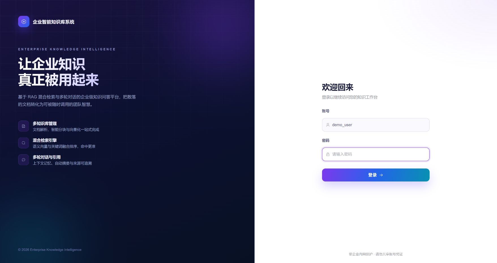
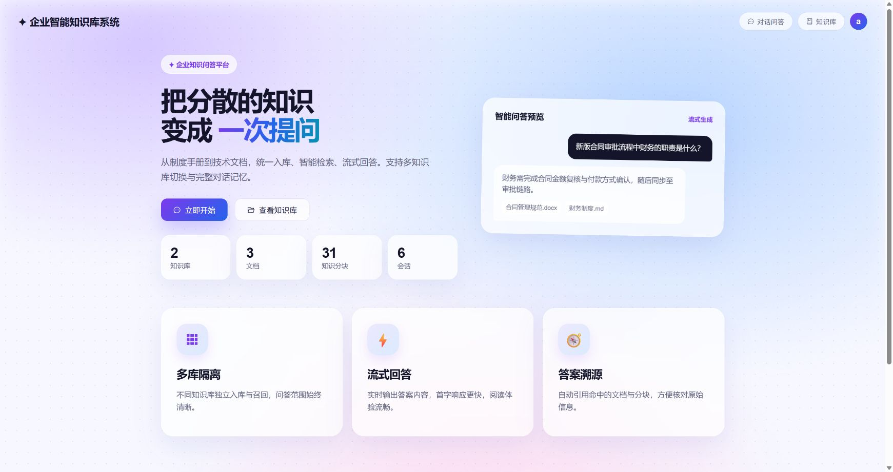
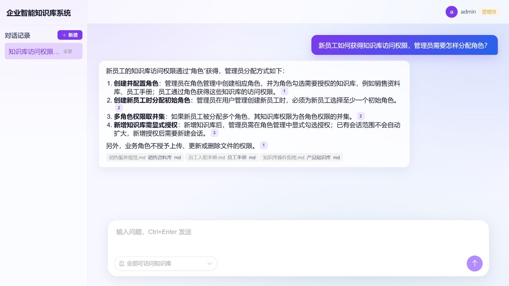
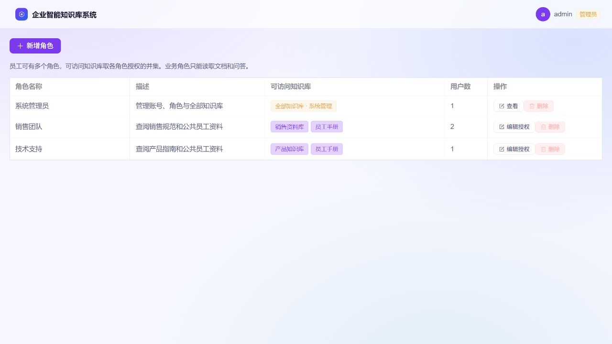
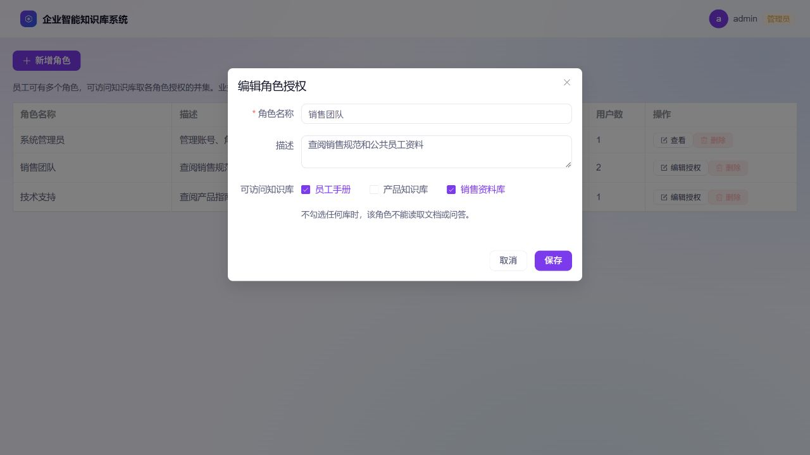
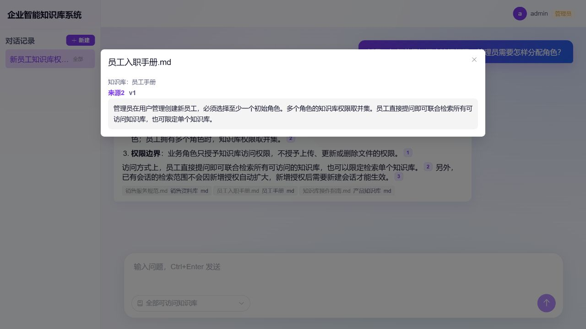
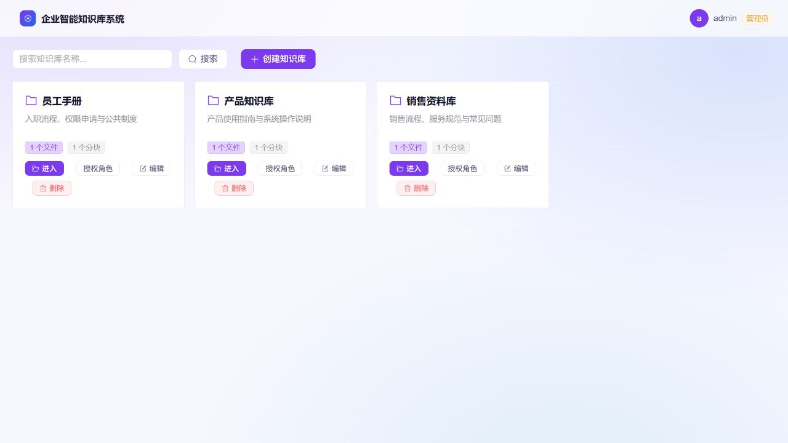
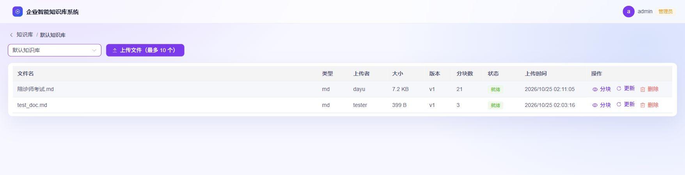
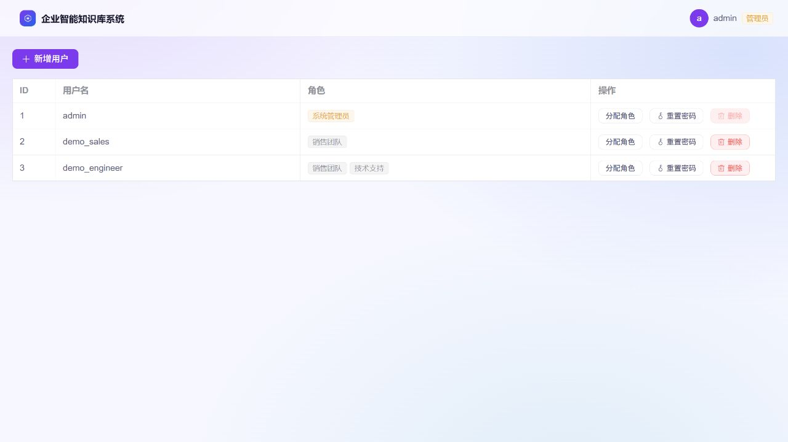
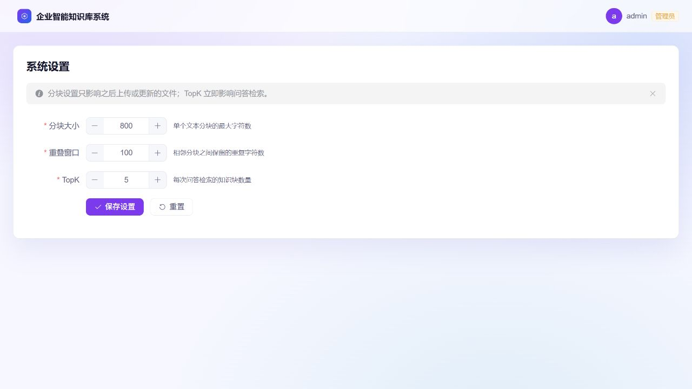

# Enterprise Knowledge Base QA System

[简体中文](./README.md) | [English](./README.en.md)

A full-stack enterprise knowledge base QA system with account authentication, role-based knowledge-base access, multi-knowledge-base management, document parsing and chunking, hybrid retrieval, streaming multi-turn conversations, and source citations.

## Screenshots

These screenshots show the current version in an isolated local demo with sample accounts and documents. They cover role-based access, cross-library Q&A and administration. Click images to view them at full size. The interface is in Chinese.

| Login | Home workspace |
|---|---|
| [](docs/assets/screenshots/login.jpg) | [](docs/assets/screenshots/home.jpg) |
| Dedicated login screen and capability overview; the password field is empty. | Knowledge base, document and chunk counts, plus chat entry points. The panel on the right is a built-in illustrative preview. |

**Cross-library Q&A and citations**: search all accessible knowledge bases by default, or narrow the scope using the selector at the lower left of the composer. Numbered citations and library/document tags identify each source. The answer below was generated by the real model from sample documents.

[](docs/assets/screenshots/chat.jpg)

<details>
<summary>View roles, grants, source text, knowledge bases, files, users and settings</summary>

### Roles and knowledge-base grants

Manage library grants centrally on each role. The built-in administrator cannot be reduced; roles assigned to employees cannot be deleted.





### Source text

Inspect the source library, document version and the precise chunk loaded on demand.



### Knowledge bases

View file/chunk counts, search knowledge bases, open their files, and use administrator create, edit and delete controls.



### Files

Inspect file types, versions, processing status and chunk counts; upload, view chunks, update or delete documents.



### Users

The user list displays multiple role tags. New users require at least one explicitly selected role, and administrators may adjust role assignments. All accounts shown are demo accounts.



### System settings

Configure chunk size, overlap and retrieval TopK, with guidance on which settings affect future ingestion or current retrieval.



</details>

## Features

- **Login and user management**: username/password login with JWT authentication. System administrators can create users, assign roles, reset passwords, and delete users. New users require at least one explicitly selected initial role; no generic user role is assigned automatically.
- **Roles and knowledge-base access**: select accessible knowledge bases on the role management page. Employees may hold multiple roles and receive the union of their authorized knowledge bases. Business roles grant document reading and Q&A only. The built-in system administrator role has access to all knowledge bases and system management; it cannot be deleted or reduced, and the last administrator cannot be removed. Reassign users before deleting an occupied role. Each knowledge base has a read-only view of authorized roles; edit grants in role management.
- **Personal security**: password changes and admin resets invalidate existing JWTs. New passwords require 6–128 characters and cannot be all whitespace. Login responses and browser user storage contain only public user fields.
- **Multi-knowledge-base support**: admins can create, edit, and delete knowledge bases. Users can only view authorized knowledge bases, their statistics, files, and chunks.
- **File management**: supports `md`, `txt`, `docx`, `pdf`, and `pptx`. Admins can upload up to 10 files at a time to a selected knowledge base. Parsing, chunking, and embedding run in the background with statuses `processing`, `ready`, or `failed`.
- **AI Q&A**: users search all accessible knowledge bases by default and may optionally narrow a new conversation to one knowledge base. Responses stream token by token, preserve multi-turn context, auto-generate a concise conversation title after the first answer, and honestly state when the knowledge base has no relevant content instead of making up answers.
- **Hybrid retrieval**: pgvector semantic search combined with PostgreSQL full-text search (zhparser Chinese word segmentation, GIN index), fused with Reciprocal Rank Fusion (RRF); when either the vector or keyword channel fails, results automatically fall back to the single healthy channel.
- **Safe updates and citations**: uploads default to a 50MB per-file limit. Successful updates replace chunks and increment the version; failures preserve original data. Inline citation badges load individual chunks with file/version checks; legacy references show saved excerpts.
- **Performance and context**: an HNSW cosine similarity index is created for `chunks.embedding` at startup. The recent conversation history sent to the LLM is limited to 20 messages by default. When total messages exceed 30, older messages are automatically compressed into a summary and combined with the recent 20 for the LLM.
- **System settings**: admins can configure chunk size, chunk overlap, and TopK.
- **Security**: login attempts are limited by client IP with expiry and bounded storage. By default, five failures within 15 minutes block that source for 15 minutes. Trusted proxies overwrite external forwarding headers. Sensitive operations are audited.
- **Automated tests**: core flows cover login, user management, file upload, and docx-aware splitting. Optional retrieval regression cases are also available.

For a fresh installation, `admin / 123456` is created on first startup and assigned the built-in system administrator role. Change the password immediately. Existing databases require the migration below; existing non-administrators receive no automatic grants.

Conversations snapshot all accessible knowledge bases at creation by default, or may be limited to one. The scope stays fixed; start a new conversation to include newly granted libraries. Revoking access hides related conversation lists, history and citations, blocks subsequent questions, and stops an active answer with a permission-change message. Content already displayed cannot be recalled. Reauthorization restores access to history created under the new role system, but invalidated model context is not restored. Department inheritance and document-level grants are outside this release. Deleting a knowledge base with conversations or a user with related records returns `409`.

## Tech Stack

| Layer | Technology |
|---|---|
| Frontend | Vite + Vue 3 + Element Plus + Vue Router |
| Backend | Python 3.13 + FastAPI + SQLAlchemy Async |
| Orchestration | LangChain 1.x / LangGraph |
| Vector store | pgvector (PostgreSQL extension; vectors and chunks share one transactional database) |
| Relational database | PostgreSQL (Docker) |
| Embedding | Ollama `bge-m3` by default; OpenAI-compatible online embedding APIs are also supported |
| Chat model | OpenAI-compatible API (Volcengine Ark by default, replaceable) |
| Conversation memory | LangGraph Postgres Checkpoint |

## Project Structure

```text
backend/
  app/
    main.py               # Application entry: migrations, startup checks, Graph setup
    config.py             # Reads backend/.env
    models.py             # SQLAlchemy models
    auth.py               # JWT, password hashing, current-user/admin dependencies
    routers/              # auth / users / roles / knowledge-bases / files / chunks / chat / settings
    services/
      document_service.py # Document parsing, chunking, embedding, status updates
      retrieval_service.py# pgvector + keyword hybrid retrieval with single-channel fallback
      rag_service.py      # LangGraph RAG orchestration
      settings_service.py # Runtime system settings
  requirements.txt
  .env                    # Local configuration, not committed
frontend/
  src/
    components/           # Layout and sidebar
    views/                # Login / Home / Chat / Knowledge bases / Files / Users / Roles / Settings
    router/index.js       # Lazy-loaded routes and login guard
    store.js              # Global token, user, conversation, and KB state
docs/                     # Chinese requirements and design documents
```

## Prerequisites

1. Python 3.13
2. Node.js 20.19+ (20.x) or 22.12+ / npm, as required by the current Vite package
3. Docker running PostgreSQL
4. An embedding service: Ollama with `EMBED_MODEL` pulled by default (`bge-m3`), or an OpenAI-compatible online embedding provider
5. An OpenAI-compatible LLM API key

## Local Development

### 1. Start PostgreSQL

```bash
docker start my-postgres
```

If you have not created a PostgreSQL container yet, use a pgvector-enabled PostgreSQL 16 image and expose it on your desired port.

### 2. Configure the backend

```bash
cd backend
python -m venv .venv
.venv\Scripts\activate
pip install -r requirements.txt
copy .env.example .env
```

Edit `backend/.env`, configure `DATABASE_URL` and `LLM_API_KEY`, and set a random `JWT_SECRET`.

### 3. Start the backend

The initialization below applies to an empty database. For an existing database, stop the backend, back up data, and complete the [role-access migration](docs/角色权限迁移.md) before starting the new version.

```bash
cd backend
.venv\Scripts\python run.py
```

On Windows, start the app with `run.py`. It selects `SelectorEventLoop`, which is required by the psycopg async driver. Do not run `uvicorn app.main:app` directly on Windows.

On first startup, the backend automatically:

- Creates database tables.
- Creates the built-in system administrator role and the associated default admin account `admin / 123456`.
- Creates the default knowledge base.
- Initializes LangGraph Postgres Checkpoint.
- Initializes default system settings.

Missing embeddings are rebuilt in separate per-file transactions. Failures roll back and are logged while other files continue. Backfill failure alone does not prevent startup; database and Checkpoint initialization must still succeed. Restart after restoring dependencies to retry failed backfills. Background jobs run in the application process and are not durable or resumable.

### 4. Start the frontend

```bash
cd frontend
npm install
npm run dev
```

Open http://localhost:5173.

## Configuration

Important variables in `backend/.env`:

| Variable | Description |
|---|---|
| `DATABASE_URL` | PostgreSQL connection URL |
| `UPLOAD_DIR` / `EMBED_DIM` | Upload directory and vector dimension; default `1024` for `bge-m3` |
| `CHUNK_SIZE` / `CHUNK_OVERLAP` | Default chunking parameters |
| `TOP_K` | Default number of retrieved chunks |
| `RETRIEVAL_MIN_SCORE` | Vector similarity threshold; default `0.5`, lower means looser |
| MAX_HISTORY_MESSAGES | Recent messages sent to the LLM; default 20 |
| SUMMARY_TRIGGER_MESSAGES | Message count threshold to trigger summarization; default 30 |
| SUMMARY_BATCH_SIZE | Number of old messages per summarization batch; default 10 |
| MAX_UPLOAD_MB | Maximum size of a single uploaded file in MB; default 50 |
| `EMBED_PROVIDER` | Embedding provider: `ollama` or `openai` |
| `OLLAMA_BASE_URL` / `EMBED_MODEL` | Local embedding service and model |
| `EMBED_OPENAI_BASE_URL` / `EMBED_OPENAI_API_KEY` | OpenAI-compatible online embedding endpoint and API key |
| `EMBED_OPENAI_DIMENSIONS` / `EMBED_DIM` | Online model output dimension and PostgreSQL vector column dimension; they must match |
| `LLM_BASE_URL` / `LLM_API_KEY` / `LLM_MODEL` | OpenAI-compatible chat model configuration |
| `JWT_SECRET` / `JWT_EXPIRE_HOURS` | JWT signing settings |
| `LOGIN_MAX_ATTEMPTS` / `LOGIN_LOCK_MINUTES` | Per-source failure threshold, counting window and block duration; defaults: 5 attempts / 15 minutes |
| `TRUSTED_PROXY_IPS` | Explicit trusted proxy addresses; locally `127.0.0.1,::1`, overridden by Compose with the frontend proxy address |

Settings saved by an admin in the **System Settings** page override the `.env` defaults for `CHUNK_SIZE`, `CHUNK_OVERLAP`, and `TOP_K`.

When switching to an online embedding provider, make sure `EMBED_DIM` matches the model output dimension. For example, Alibaba Cloud DashScope `text-embedding-v3` can use `1024`. Switching to a model with a different dimension requires clearing and rebuilding existing vector data.

## Docker Deployment

Create a root-level `.env` file based on `backend/.env.example`. Fill in at least `JWT_SECRET` and `LLM_API_KEY`, then run:

```bash
docker compose up -d --build
```

Open http://localhost:8080. Change the exposed port with the `FRONTEND_PORT` environment variable. PostgreSQL data and uploaded files are persisted through Docker volumes.

Compose assigns the frontend proxy `172.30.250.3` and configures the backend to trust only that address. If this subnet conflicts with an existing network, set both `QA_PROXY_SUBNET` (default `172.30.250.0/24`) and `QA_PROXY_IP` in the root `.env`, then recreate the service network without deleting data volumes. Do not set trusted proxies to `*`. Additional reverse proxies require an explicit trust boundary and header replacement; see [the login protection design](docs/登录防暴力破解设计.md).

The database uses a self-built image (`backend/docker/Dockerfile.pgvector`, compiling SCWS + zhparser on top of `pgvector/pgvector:pg16`). After changing zhparser segmentation parameters or custom dictionaries, run `REINDEX INDEX idx_chunks_content_fts` in the database.

## Tests

Windows PowerShell commands; install optional test tools in the backend virtual environment:

```powershell
cd backend
.\.venv\Scripts\python.exe -m pip install pytest pytest-asyncio httpx aiosqlite
.\.venv\Scripts\python.exe -B -m pytest tests -q -p no:cacheprovider
```

```powershell
cd frontend
node --test tests/*.spec.js
npm run build
```

Backend tests use isolated temporary SQLite and mocked models by default. Two retrieval cases need local PostgreSQL, an embedding service, and the knowledge base/documents configured in `tests/test_retrieval_regression.py`; adapt its IDs and expected sources to your data. From `backend/`, set `$env:RUN_RETRIEVAL_TESTS='1'` and run `.\.venv\Scripts\python.exe -m pytest tests/test_retrieval_regression.py -q`. Full-text search verification requires setting `FTS_POSTGRES_TESTS=1` (PostgreSQL with zhparser is needed). Role-access tests cover role assignment, knowledge-base isolation, revocation, and frontend identity refresh. Use the current local run for pass counts. Docker deployment and concurrency load testing are not included.

## Upgrade Notes

This release uses a fresh role-based API contract and does not support the old `role` enum API or pre-release conversations. Existing knowledge bases, documents and vectors are retained. Earlier conversations are unavailable, and their model Checkpoints are not reused.

For an existing database, stop the old backend and back up the database and original uploaded files first. **The first role migration permanently deletes old conversations/messages and drops `users.role`; recovery requires the pre-migration backup.** Re-running it after initialization preserves new conversations. The separate scope migration only adds metadata and does not delete conversations. From the repository root, run the read-only plan and then explicitly apply the migration. Start the new backend only after it succeeds:

```powershell
.\backend\.venv\Scripts\python.exe backend/scripts/migrate_roles.py --plan
.\backend\.venv\Scripts\python.exe backend/scripts/migrate_roles.py --apply
.\backend\.venv\Scripts\python.exe backend/scripts/migrate_chat_scope.py --plan
.\backend\.venv\Scripts\python.exe backend/scripts/migrate_chat_scope.py --apply
```

Migration assigns former administrators to the built-in system administrator role. Former non-administrators retain zero roles and zero knowledge-base grants until an administrator explicitly assigns roles. No compatibility role preserving shared access is created. See [role-access migration](docs/角色权限迁移.md) and [cross-library Q&A](docs/跨库问答说明.md) for details. The scope migration only adds conversation scope metadata and retains existing single-library conversations.

- User responses contain `roles` and `is_admin`. Creating users and assigning roles require a nonempty `role_ids` array; the old `role` field is no longer accepted.
- On startup, the browser discards cached user identity and fetches the current identity before displaying permissions. Sign in again after upgrading.
- Full citation text is fetched on each dialog opening. Legacy references without stable identifiers cannot recover historical full text; old citations for updated files can only show saved excerpts.
- Limits are per-process and reset on restart. Users sharing a public NAT address share a budget; multiple instances need coordinated rate limiting.

## Usage Flow

1. Log in with `admin / 123456`.
2. Open **Knowledge Bases** and create or select a knowledge base.
3. Upload files inside the selected knowledge base, up to 10 at a time. Wait for their status to change from **processing** to **ready**.
4. Open **Role Management**, create business roles and select their accessible knowledge bases. Roles without grants can sign in but cannot read documents or ask questions.
5. Create employees in **User Management** and explicitly select at least one initial role. Multiple roles grant the union of their knowledge bases; assignments can be edited later. The authorized-roles entry on each knowledge base is read-only.
6. Employees open **Chat** and ask directly across all accessible knowledge bases, or optionally select one. The first message creates a conversation with a fixed scope; the sidebar only lists conversations whose entire scope remains authorized.
7. Admins can open **System Settings** from the top-right menu to adjust retrieval and chunking parameters.

## Documentation

The design documents are maintained in Chinese:

- [`docs/需求文档.md`](docs/需求文档.md)
- [`docs/设计文档.md`](docs/设计文档.md)
- [`docs/检索优化需求与设计.md`](docs/检索优化需求与设计.md)
- [`docs/关键词检索优化设计.md`](docs/关键词检索优化设计.md)
- [`docs/异步向量化设计.md`](docs/异步向量化设计.md)
- [`docs/docx切分优化设计.md`](docs/docx切分优化设计.md)
- [Role-access migration](docs/角色权限迁移.md)
- [`docs/pgvector迁移设计.md`](docs/pgvector迁移设计.md)
- [`docs/登录防暴力破解设计.md`](docs/登录防暴力破解设计.md)
- [docs/审计日志与自动化测试设计.md](docs/审计日志与自动化测试设计.md)
- [docs/对话上下文摘要策略设计.md](docs/对话上下文摘要策略设计.md)
- [docs/变更记录.md](docs/变更记录.md)

These documents are the baseline for requirements and implementation alignment.
