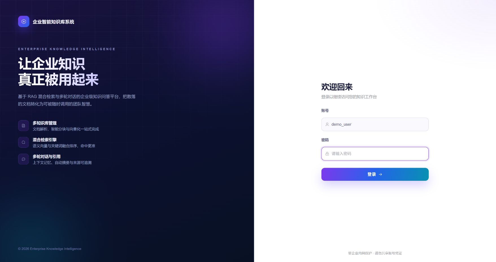
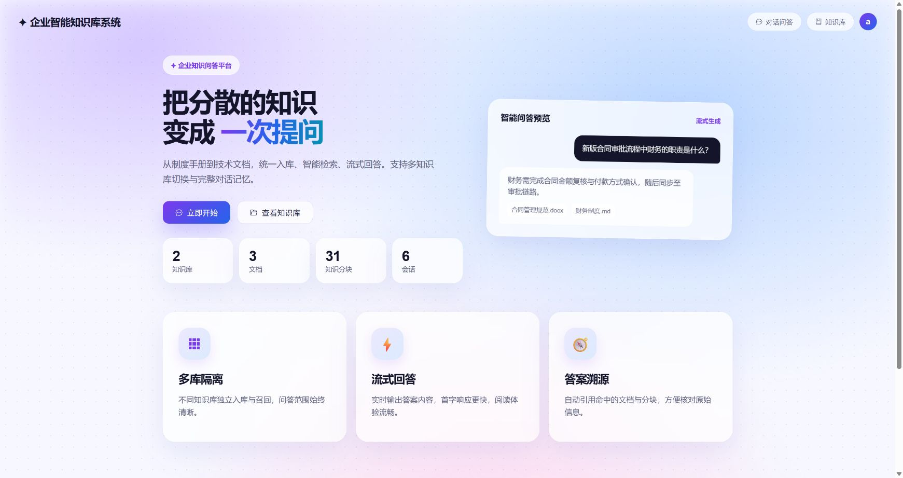
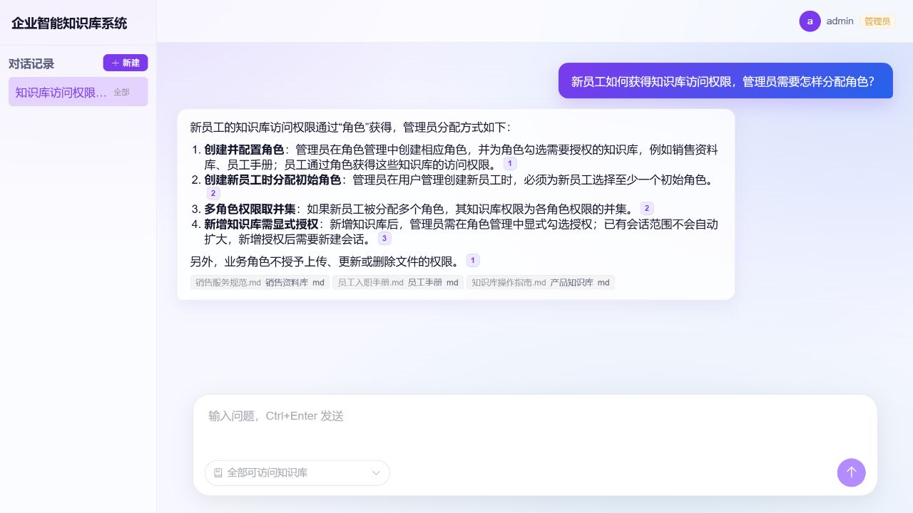
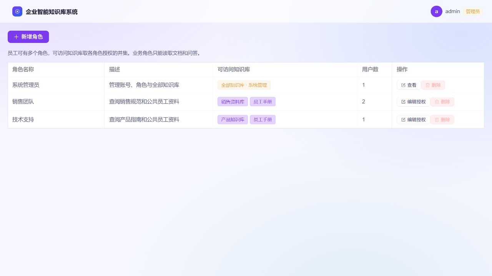
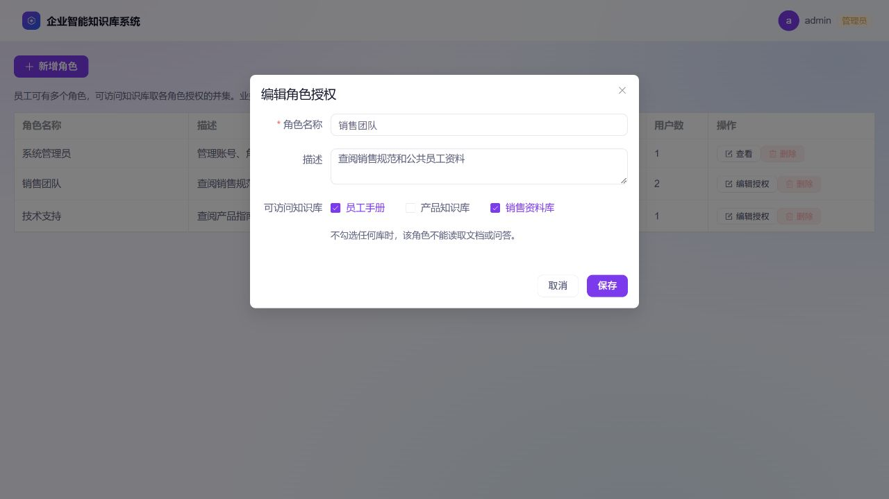
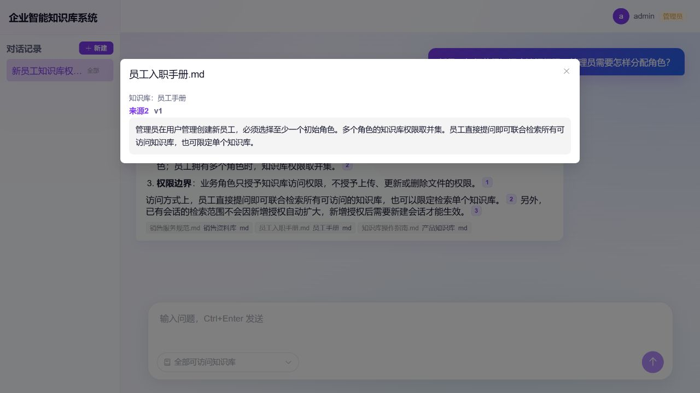
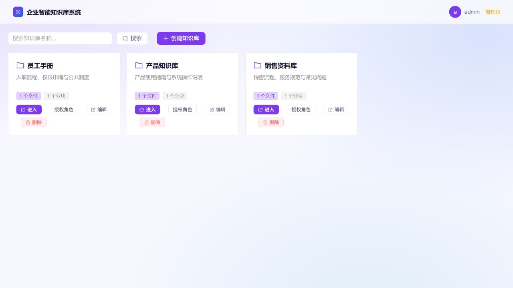
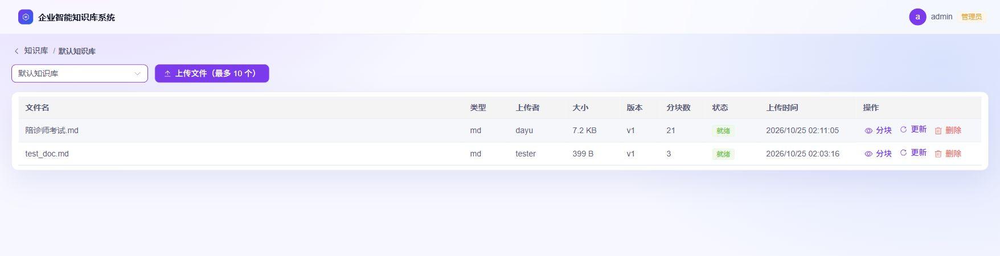
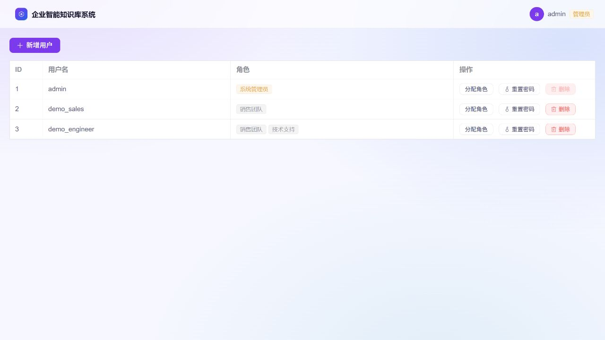
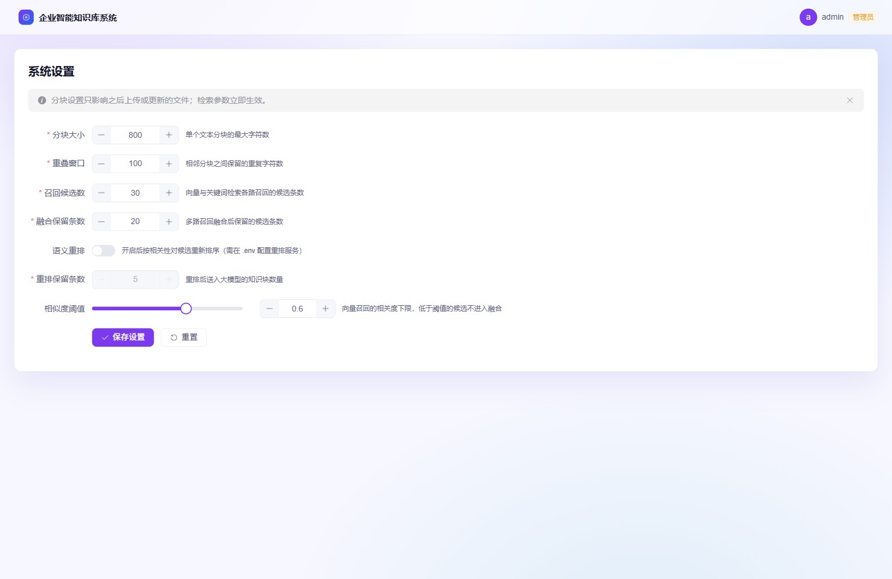

# 企业知识库问答系统

[English](./README.en.md) | [简体中文](./README.md)

前后端分离的企业知识库问答系统：支持账号密码登录、角色与知识库授权、多知识库管理、文件解析分块、混合检索与语义重排、流式多轮问答与来源引用。

## 界面预览

以下截图来自本地隔离演示环境，使用示例账号与资料，展示角色授权、跨库问答及管理流程。点击图片可查看原图。

| 登录 | 首页工作台 |
|---|---|
| [](docs/assets/screenshots/login.jpg) | [](docs/assets/screenshots/home.jpg) |
| 独立登录页与产品能力介绍，密码栏留空。 | 知识库、文档与分块统计，以及对话入口；右侧为页面内置问答示意。 |

**跨库问答与来源引用**：默认查询全部可访问知识库，也可在输入框左下角限定单库。上方输入、下方选择范围与发送；回答通过数字角标和知识库/文档标签标注来源。下图回答为演示资料上的真实模型输出。

[](docs/assets/screenshots/chat.jpg)

<details>
<summary>展开查看角色授权、引用原文、知识库、文件、用户和系统设置页面</summary>

### 角色管理与知识库授权

在角色页集中勾选知识库；内置系统管理员不可缩权，已分配员工的角色不可删除。





### 引用原文

显示来源知识库、文档和版本，按需加载对应分块原文。



### 知识库管理

按知识库查看文件数与分块数，支持搜索、进入文件列表，以及管理员创建、编辑和删除。



### 文件管理

查看文件类型、版本、处理状态和分块数，支持上传、查看分块、更新与删除。



### 用户管理

用户列表展示角色标签；新增用户必须选择至少一个角色，管理员可为员工调整多个角色。图中账号均为示例。



### 系统设置

分块参数、召回候选数、融合保留条数、语义重排开关与重排保留条数、相似度阈值滑块集中在一页；页面说明哪些参数影响后续入库，哪些立即影响问答。



</details>

## 功能概览

- **登录与用户管理**：账号密码登录，JWT 鉴权；系统管理员可新增用户、分配角色、重置密码、删除用户。新增用户必须明确选择至少一个角色，没有自动套用的“普通用户”角色。
- **角色与知识库授权**：在角色管理页勾选可访问知识库；员工可有多个角色，可读知识库取并集。业务角色只能读取文档和问答；内置“系统管理员”拥有全部知识库与系统管理权限，不能删除或缩权，不能移除最后一名系统管理员。使用中的角色须先调整关联用户才能删除。知识库侧提供已授权角色的只读视图，授权统一在角色管理维护。
- **个人安全**：个人改密或管理员重置密码后，该账号的旧 JWT 立即失效；新密码要求 6～128 位且非全空白。登录响应和浏览器用户缓存仅保留公开字段。
- **多知识库**：管理员创建 / 编辑 / 删除知识库，用户仅能查看已授权知识库的列表、统计、文件及分块。
- **文件管理**：支持 `md` / `txt` / `docx` / `pdf` / `pptx`（pptx 按页拆分，页标题作层级、演讲者备注带【备注】前缀）；表格感知分块保留 Markdown 表格结构。管理员可在指定知识库内一次最多上传 10 个文件，解析、切分和向量化在后台执行，状态为“处理中 / 就绪 / 失败”。
- **智能问答**：默认检索全部可访问知识库，也可限定单库；支持流式输出、多轮上下文记忆、会话列表和历史记录恢复；首轮回答后自动生成简洁会话标题；知识库未命中内容时如实说明，不编造答案。
- **三段式混合检索**：向量检索（pgvector，HNSW 索引，相似度阈值过滤）与关键词检索（zhparser 中文分词 + GIN 索引，AND 零命中 OR 兜底）各取“召回候选数”，RRF 融合后保留“融合保留条数”，开启语义重排时精排后取“重排保留条数”送大模型；各级条数与阈值均可在设置页调整。向量或关键词通道异常时自动降级为单通道结果，向量零命中时保守返回空。
- **语义重排（Rerank）**：设置页开关，调用 DashScope `gte-rerank-v2` 对融合候选按相关性重新打分排序；重排服务未配置或调用失败时自动按融合顺序降级，不影响问答可用性。
- **文件更新保护**：单文件默认上限 50MB；更新成功后才切换分块并递增版本，失败保留原文件和分块。
- **来源引用**：正文使用数字角标；来源弹窗按需加载单个分块并核对文件版本，文件更新或删除后明确提示失效。
- **性能与上下文**：启动时为 `chunks.embedding` 创建 HNSW 余弦相似度索引；发送给大模型的最近历史消息默认限制为 20 条，更早的旧消息累积满一批后自动滚动压缩为摘要，与最近消息一起传给大模型，避免上下文无限增长。
- **系统设置**：管理员可配置分块大小、重叠窗口、召回候选数、融合保留条数、重排保留条数、语义重排开关与相似度阈值（0.1～0.9 步长 0.1 的滑块）。
- **安全**：按客户端来源 IP 限流，默认 15 分钟内累计失败 5 次后限制该来源 15 分钟；仅信任明确代理，计数有过期清理与容量上限。敏感操作审计日志落库。
- **自动化测试**：后端覆盖认证与令牌撤销、会话范围、检索回归、重排链路、文件更新回滚、引用加载、启动异常隔离及代理来源识别，默认使用隔离 SQLite 与模拟模型；前端使用 Node 内置测试。

会话默认使用创建时全部可访问知识库，也可限定单库；创建后范围固定，新增授权需新建会话才能纳入。撤销知识库权限后，相关会话列表、历史、来源与后续问答均不可访问；进行中的回答会停止并提示权限变更，已经展示的内容无法撤回。重新授权后可再次读取本次角色系统下的历史，但作废的模型上下文不会恢复。首版不提供部门继承或文档级授权。删除有关联会话的知识库或有关联数据的用户会返回 `409`。

全新安装的默认管理员账号：`admin / 123456`，首次启动自动创建并关联内置“系统管理员”角色，请尽快修改密码。

## 技术栈

| 层次 | 选型 |
|---|---|
| 前端 | Vite + Vue 3 + Element Plus + Vue Router |
| 后端 | Python 3.13 + FastAPI + SQLAlchemy Async |
| 编排 | LangChain 1.x / LangGraph |
| 向量库 | pgvector（PostgreSQL 扩展，向量与 chunk 同库同事务） |
| 关系库 | PostgreSQL（Docker，自建 pgvector + zhparser 镜像） |
| Embedding | 默认 Ollama `bge-m3`；支持 OpenAI 兼容在线模型（如阿里云百炼） |
| 重排 | DashScope text-rerank 协议（`gte-rerank-v2`），可选 |
| 对话模型 | OpenAI 兼容协议（默认火山方舟，可替换其他供应商） |
| 对话记忆 | LangGraph Postgres Checkpoint |

## 项目结构

```text
backend/
  app/
    main.py               # 应用入口，负责建表、初始化数据、启动 Graph
    config.py             # 读取 backend/.env
    models.py             # SQLAlchemy 模型
    auth.py               # JWT、密码哈希、当前用户和管理员依赖
    routers/              # auth / users / roles / knowledge-bases / files / chunks / chat / settings
    services/
      document_service.py # 文档解析、分块、向量化、状态回写
      retrieval_service.py# 向量 + 关键词混合检索、RRF 融合、可选重排与降级
      rerank_service.py   # 语义重排客户端（DashScope text-rerank）
      rag_service.py      # LangGraph RAG 编排
      settings_service.py # 运行时系统设置
  requirements.txt
  .env                    # 本地配置，不提交
frontend/
  src/
    components/           # 布局和侧边栏
    views/                # 登录 / 首页 / 对话 / 知识库 / 文件 / 用户 / 角色 / 设置
    router/index.js       # 路由与登录守卫
    store.js              # 全局 token、用户、会话状态
docs/                     # 需求、设计和专项方案
```

## 环境准备

1. Python 3.13
2. Node.js 20.19+（20.x）或 22.12+ / npm（按当前 Vite 的 engines 要求）
3. Docker 运行中的 PostgreSQL
4. Embedding 服务：默认使用 Ollama，并已拉取 `EMBED_MODEL`（默认 `bge-m3`）；也可改用 OpenAI 兼容在线模型
5. 大模型 API Key（OpenAI 兼容协议）；如需语义重排，另备 DashScope API Key

## 启动步骤

### 1. 启动 PostgreSQL

需要一个带 pgvector 与 zhparser 扩展的 PostgreSQL 16。可用自建镜像：

```bash
docker build -f backend/docker/Dockerfile.pgvector -t knowledge-qa/pg16-zhparser:latest .
docker run -d --name my-postgres -e POSTGRES_PASSWORD=postgres -p 5432:5432 knowledge-qa/pg16-zhparser:latest
```

已有容器直接 `docker start my-postgres`。zhparser 扩展不可用时系统自动降级为纯向量检索并记日志；调整分词参数或自定义词典后需在库内执行 `REINDEX INDEX idx_chunks_content_fts`。

### 2. 配置后端环境

```bash
cd backend
python -m venv .venv
.venv\Scripts\activate
pip install -r requirements.txt
copy .env.example .env
```

编辑 `backend/.env`，配置 `DATABASE_URL`、`LLM_API_KEY`，并将 `JWT_SECRET` 改为随机密钥。

### 3. 启动后端

```bash
cd backend
.venv\Scripts\python run.py
```

Windows 下必须使用 `run.py` 启动，因为它会为 psycopg Async 指定 `SelectorEventLoop`。不要直接使用 `uvicorn app.main:app`。

首次启动会自动：

- 创建数据表并补齐系统设置列；
- 创建内置“系统管理员”角色及关联的默认管理员 `admin / 123456`；
- 创建「默认知识库」；
- 初始化 LangGraph Postgres Checkpoint；
- 初始化系统设置默认值。

启动时会补齐缺失向量：每个文件独立提交，失败回滚并记录日志，其他文件继续处理。补齐失败不会单独阻断应用启动，但数据库和 Checkpoint 初始化仍须成功；失败文件可在依赖恢复后重启重试。后台任务运行在应用进程内，尚不支持任务持久化或断点续传。

### 4. 启动前端

```bash
cd frontend
npm install
npm run dev
```

打开：http://localhost:5173

## 配置说明

`backend/.env` 主要配置（每个字段的逐条注释见 `backend/.env.example`）：

| 配置项 | 说明 |
|---|---|
| `DATABASE_URL` | PostgreSQL 连接串 |
| `UPLOAD_DIR` | 上传文件目录 |
| `EMBED_DIM` | PostgreSQL 向量列维度（默认 1024，对应 bge-m3；换维度需清空 chunks 并调整列宽） |
| `CHUNK_SIZE` / `CHUNK_OVERLAP` | 分块参数种子值 |
| `TOP_K` / `RRF_TOP_N` / `TOP_N` | 每路召回候选数 / RRF 融合后保留条数 / 重排后送大模型条数（默认 30 / 20 / 5） |
| `RETRIEVAL_MIN_SCORE` | 向量召回相似度阈值（默认 `0.5`，仅作用于向量路） |
| `MAX_HISTORY_MESSAGES` / `SUMMARY_BATCH_SIZE` | 发送给大模型的最近历史消息数（默认 20）/ 摘要压缩批大小（默认 10） |
| `MAX_UPLOAD_MB` | 单个上传文件大小上限，单位 MB（默认 50） |
| `EMBED_PROVIDER` | Embedding 供应商：`ollama` 或 `openai` |
| `OLLAMA_BASE_URL` / `EMBED_MODEL` | 本地 Embedding 服务和模型 |
| `EMBED_OPENAI_BASE_URL` / `EMBED_OPENAI_API_KEY` / `EMBED_OPENAI_DIMENSIONS` | OpenAI 兼容在线 Embedding 地址、密钥与输出维度 |
| `RERANK_PROVIDER` / `RERANK_MODEL` / `RERANK_API_KEY` / `RERANK_BASE_URL` | 语义重排连接配置（`none` 时不调用） |
| `LLM_BASE_URL` / `LLM_API_KEY` / `LLM_MODEL` | 大模型接口配置（OpenAI 兼容协议） |
| `JWT_SECRET` / `JWT_EXPIRE_HOURS` | JWT 签发配置 |
| `LOGIN_MAX_ATTEMPTS` / `LOGIN_LOCK_MINUTES` | 来源 IP 的失败阈值、计数窗口及限制时长，默认 5 次 / 15 分钟 |
| `TRUSTED_PROXY_IPS` | 可信代理地址列表，本地默认 `127.0.0.1,::1`；Compose 使用固定前端代理地址 |

注意：管理员在「系统设置」页保存的 `chunk_size`、`chunk_overlap`、`top_k`、`rrf_top_n`、`top_n`、`rerank_enabled`、`retrieval_min_score` 优先于 `.env` 中的默认值；`.env` 中的检索参数仅作为首次初始化的种子值。

切换在线 Embedding 时，请确认 `EMBED_OPENAI_DIMENSIONS` 与 `EMBED_DIM` 一致（例如阿里云百炼 `text-embedding-v3` 可配置 `1024`）。不同模型的向量空间不可混用，切换后需要清空并重建已有向量数据。

## Docker 部署

在项目根目录创建 `.env`（参考 `backend/.env.example`），至少填写 `JWT_SECRET` 和 `LLM_API_KEY`，然后：

```bash
docker compose up -d --build
```

浏览器访问 `http://localhost:8080`（通过 `FRONTEND_PORT` 变量可修改端口）。数据库和上传文件通过 Docker Volume 持久化。

登录限流依赖可信代理边界：Compose 将前端代理固定在 `172.30.250.3`，后端只信任该地址。若代理网段与本机网络冲突，在根目录 `.env` 同时调整 `QA_PROXY_SUBNET`（默认 `172.30.250.0/24`）和其内的 `QA_PROXY_IP`，然后重建服务网络，无需删除数据卷。额外反向代理及多实例部署参见 [登录防暴力破解设计](docs/登录防暴力破解设计.md)，不要将可信代理配置为 `*`。

数据库使用自建镜像（backend/docker/Dockerfile.pgvector，基于 pgvector/pgvector:pg16 编译 SCWS + zhparser）。

## 运行测试

以下命令在 Windows PowerShell 中运行，测试依赖按需安装到后端虚拟环境：

```powershell
cd backend
.\.venv\Scripts\python.exe -m pip install pytest pytest-asyncio httpx aiosqlite
.\.venv\Scripts\python.exe -B -m pytest tests -q -p no:cacheprovider
```

```powershell
cd frontend
node --test tests/*.spec.js
npm run build
```

后端测试默认使用隔离临时 SQLite 和模拟模型，不需要真实模型服务；两项真实检索回归默认跳过。集成验证需准备 PostgreSQL、Embedding 服务及 `tests/test_retrieval_regression.py` 中配置的知识库/样例文件，按实际环境调整 ID 和预期来源；在 `backend/` 设置 `$env:RUN_RETRIEVAL_TESTS='1'` 后运行 `.\.venv\Scripts\python.exe -m pytest tests/test_retrieval_regression.py -q`。全文检索验证需设置 `FTS_POSTGRES_TESTS=1`（需要带 zhparser 的 PostgreSQL）。具体通过数量以本地运行结果为准，不包含 Docker 端到端部署或并发压测。

## 使用流程

1. 使用 `admin / 123456` 登录。
2. 进入「知识库」，创建或选择知识库。
3. 在知识库内上传文件（单次最多 10 个），等待状态从“处理中”变为“就绪”。
4. 管理员进入「角色管理」，创建业务角色并勾选其可访问知识库；空授权角色可登录但不能读取文档或问答。
5. 进入「用户管理」新增员工，明确选择至少一个初始角色；多个角色的知识库权限取并集，后续可调整。知识库中的「授权角色」入口只读查看对应关系。
6. 员工进入「对话」，直接提问，默认检索全部可访问知识库；也可在输入框左下角限定单库。首条消息自动创建会话；左侧只列出当前仍有权限的会话。
7. 管理员可在右上角进入「系统设置」，调整分块与检索参数：召回候选数、融合保留条数、语义重排开关、重排保留条数与相似度阈值滑块。

## 文档

- [`docs/需求文档.md`](docs/需求文档.md)
- [`docs/设计文档.md`](docs/设计文档.md)
- [`docs/检索优化需求与设计.md`](docs/检索优化需求与设计.md)
- [`docs/关键词检索优化设计.md`](docs/关键词检索优化设计.md)
- [`docs/异步向量化设计.md`](docs/异步向量化设计.md)
- [`docs/docx切分优化设计.md`](docs/docx切分优化设计.md)
- [`docs/在线向量模型配置设计.md`](docs/在线向量模型配置设计.md)
- [`docs/登录防暴力破解设计.md`](docs/登录防暴力破解设计.md)
- [docs/审计日志与自动化测试设计.md](docs/审计日志与自动化测试设计.md)
- [docs/对话上下文摘要策略设计.md](docs/对话上下文摘要策略设计.md)
- [`docs/变更记录.md`](docs/变更记录.md)

后续以这些文档作为需求与实现对齐基线。
